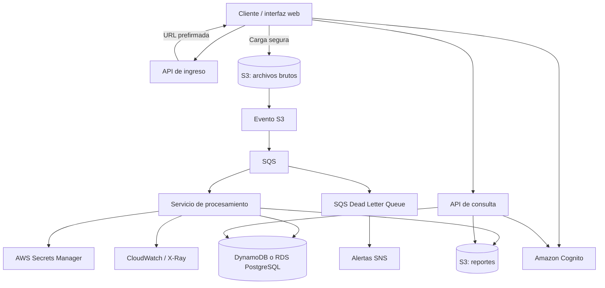

# Cloud and Application Security Task

Propuesta de arquitectura segura en AWS para la ingesta, procesamiento, almacenamiento y consulta de archivos de registro (*log files*) de sensores Rheonics.

## Objetivo

Definir una arquitectura cloud que procese archivos de sensores de forma segura y resiliente, proteja los datos de cada cliente y permita operar la solución con observabilidad, recuperación ante fallos y despliegues controlados.

## Contenido del repositorio

| Documento | Descripción |
|---|---|
| [Flujo de trabajo y arquitectura](docs/01-arquitectura-y-flujo.md) | Flujo de ingesta, procesamiento, persistencia y consulta; diagrama de arquitectura. |
| [Estrategias de almacenamiento](docs/02-almacenamiento.md) | Archivos brutos, datos estructurados, reportes y ciclo de vida. |
| [Gestión de secretos](docs/03-secretos-y-credenciales.md) | Custodia, acceso y rotación de credenciales. |
| [Autenticación y autorización](docs/04-identidad-y-accesos.md) | Cognito, JWT, MFA y aislamiento entre clientes. |
| [Protección de datos](docs/05-proteccion-de-datos.md) | Cifrado en tránsito y en reposo. |
| [Observabilidad y resiliencia](docs/06-observabilidad-y-resiliencia.md) | Métricas, alertas, trazas, copias de seguridad y recuperación. |
| [Entornos y CI/CD](docs/07-entornos-y-cicd.md) | Separación de entornos, IaC y pipeline de despliegue. |
| [Riesgos y mitigaciones](docs/08-riesgos-y-mitigaciones.md) | Riesgos principales y controles propuestos. |

## Resumen de la solución

1. El cliente solicita una URL prefirmada (*presigned URL*) y carga el archivo directamente a Amazon S3.
2. Un evento de S3 inicia el flujo de procesamiento, preferentemente desacoplado mediante Amazon SQS.
3. El servicio de procesamiento valida y parsea las métricas del archivo, como viscosidad, densidad y temperatura.
4. Los resultados estructurados se guardan en Amazon DynamoDB o Amazon RDS for PostgreSQL, según el patrón de consulta.
5. Los reportes se almacenan en un bucket de S3 separado.
6. Los usuarios autenticados consultan resultados y descargan reportes a través de una API.

## Diagrama general

## Decisiones que deben confirmarse

- **Base de datos:** DynamoDB para accesos principalmente por clave/dispositivo/fecha; RDS PostgreSQL para consultas relacionales, joins o análisis SQL.
- **Procesamiento:** AWS Lambda puede ser adecuado para tareas acotadas; para archivos grandes o dependencias de ejecución más pesadas, evaluar ECS/Fargate u otro servicio de cómputo.
- **Antimalware:** validar el mecanismo concreto de inspección de archivos. AWS Storage Gateway no es, por sí mismo, un motor antivirus; evaluar Amazon GuardDuty Malware Protection for S3 o un escáner administrado, según disponibilidad y requisitos.
- **Cifrado y retención:** confirmar clasificación de datos, requisitos regulatorios, política de claves y periodos de retención antes de fijar valores de producción.

## Seguridad básica del repositorio

- No incluir credenciales, tokens, archivos de sensores reales ni datos personales.
- Guardar parámetros sensibles en AWS Secrets Manager o en el servicio de secretos aprobado.
- Usar permisos de mínimo privilegio para roles, buckets, colas, bases de datos y pipelines.
- Revisar las políticas de retención, acceso y borrado antes de desplegar.

## Estado

Documento de diseño conceptual. Los servicios, umbrales y periodos indicados son una propuesta inicial y deben validarse con los requisitos de negocio, volumen de datos, presupuesto y controles de seguridad de la organización.
