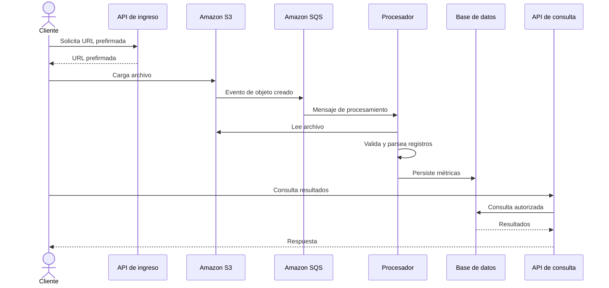

# 1. Flujo de trabajo y arquitectura

## Propósito

Describir el recorrido de un archivo de registro de un sensor Rheonics desde su carga hasta la consulta de los resultados procesados.

## Flujo funcional

1. **Ingesta:** el cliente interactúa con una interfaz web o API. El backend genera una URL prefirmada (*presigned URL*) para que el archivo se cargue directamente en el bucket de entrada.
2. **Disparador:** al crearse el objeto, Amazon S3 emite una notificación 
3. **Procesamiento:** el evento se entrega a una cola Amazon SQS y un servicio de procesamiento consume el mensaje. El servicio recupera el archivo, valida su formato y parsea las métricas necesarias, por ejemplo viscosidad, densidad y temperatura.
4. **Persistencia:** los datos validados se guardan en la base de datos seleccionada.
5. **Consumo:** una API autenticada permite consultar los datos procesados y descargar reportes consolidados.

## Diagrama de secuencia

## Controles recomendados

- Restringir las URL prefirmadas por objeto, método y tiempo de expiración.
- Validar tamaño, extensión, tipo de contenido y estructura real del archivo; no confiar solo en el nombre o el `Content-Type`.
- Hacer el procesamiento idempotente para evitar duplicados ante reintentos.
- Asociar cada archivo con un identificador de cliente (`tenant_id` o `customer_id`) y un identificador de procesamiento.
- Separar la zona de entrada de archivos no confiables de la zona de reportes y resultados.
- Evitar que un fallo de un archivo impida procesar los demás.

## Consideraciones de implementación

La propuesta menciona un backend de procesamiento. AWS Lambda es una alternativa para tareas acotadas; si los archivos exceden sus límites o requieren más memoria, tiempo o dependencias, evaluar ECS/Fargate u otro servicio. La decisión debe basarse en el tamaño de los archivos, duración del parseo, concurrencia y costo.
